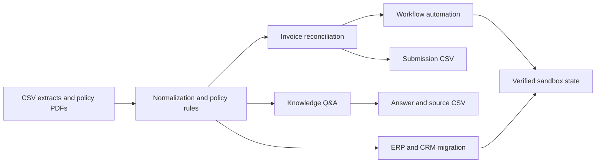

# FDE Agent for DRI Industries

A deterministic Python agent built for **The Great Indian FDE Hiring Hackathon
2026**. It reconciles invoices, answers policy questions with governing-source
citations, executes ERP/CRM workflows, and completes legacy-data migrations.

## Results

| Task family | Weight | Best score |
|---|---:|---:|
| Reconciliation | 30% | **1.0000** |
| Workflow | 30% | **1.0000** |
| Migration | 20% | **1.0000** |
| Knowledge | 20% | **0.9167** |
| **Weighted composite** | **100%** | **98.33 / 100** |

The tracked Knowledge output reproduces the best submission byte for byte:
[`submissions/knowledge_submission_best_0p9167.csv`](submissions/knowledge_submission_best_0p9167.csv).
The scores above are the final leaderboard results recorded during the contest.

## What the agent does



- **Reconciliation:** matches invoices to purchase orders, evaluates vendor,
  UOM, quantity, rate and GST rules, resolves status precedence, and detects
  duplicate billing.
- **Knowledge:** parses question parameters, resolves the policy effective on
  the transaction date, applies structured rules from four policy documents,
  and returns both an answer and governing source.
- **Workflow:** onboards a vendor, builds the MD exception report, and safely
  deduplicates CRM customers.
- **Migration:** updates the 2023 price list, maps FlowTech SKUs, and completes
  SalesTrack customer migration.

The design is deterministic where the source rules are explicit. LLM calls are
not used for arithmetic, matching, classification, or policy lookup, which
makes runs reproducible and inexpensive.

## Engineering highlights

- Typed domain models and one module per reconciliation check.
- Structured `CheckResult` evidence with observed value, expected value, and
  reason for every rule evaluation.
- Transaction-date policy resolution between PP-2019 and PP-2023.
- Indian currency parsing for comma-grouped amounts, lakh/lac, crore, decimals,
  and paise.
- Idempotent migration planning with post-write verification.
- Conservative entity resolution that refuses ambiguous matches.
- API throttling and retry handling for the sandbox's observed rate limit.
- Dry-run defaults for every workflow and migration command that can write to
  the remote sandbox.
- **159 automated tests** covering business rules, boundary cases,
  determinism, output invariants, and API payload planning.

## Repository structure

```text
configs/       Reconciliation thresholds
dataset/       Public challenge CSV extracts and policy PDFs
scripts/       CLI entry points
src/api/       Sandbox API client
src/knowledge/ Policy parsing and question answering
src/migration/ ERP and CRM migrations
src/reconciliation/ Invoice matching and classification
src/workflow/  Business workflow automation
submissions/   Best final CSVs and concise reconciliation evidence
tests/         Unit and integration-style tests with mocked APIs
```

## Run locally

Requires Python 3.10 or newer.

```powershell
python -m venv .venv
.\.venv\Scripts\Activate.ps1
python -m pip install -r requirements.txt
python -m pytest -q
```

Generate the two local CSV submissions:

```powershell
python scripts/run_reconciliation.py
python scripts/run_knowledge.py
```

The commands write:

- `submissions/submission.csv`
- `submissions/knowledge_submission.csv`

## Sandbox workflows and migrations

Create a local `.env` file from [`.env.example`](.env.example):

```text
DRI_BASE=https://example.com/api/public/sandbox/v1
DRI_KEY=replace-with-your-own-key
```

Commands that mutate the sandbox default to dry-run mode:

```powershell
python scripts/run_w1.py
python scripts/run_w2.py
python scripts/run_w3.py
python scripts/run_m1.py
python scripts/run_m2.py
python scripts/run_m3.py
```

Review the plan first, then pass `--execute` to the relevant command. Never
commit `.env` or API credentials.

## Key implementation choices

1. **Exact matching before normalization.** PO resolution uses the supplied
   identifier first and only applies conservative case/whitespace normalization.
2. **Explicit failure states.** Unknown question shapes and ambiguous product
   matches surface for review instead of producing confident guesses.
3. **One shared rule engine.** Workflow reporting reuses reconciliation logic,
   and vendor onboarding reuses the policy knowledge base.
4. **Verify writes.** Mutation scripts re-fetch affected records and validate
   the resulting state.

## Notes

The dataset and business names are part of the hackathon's fictional DRI
scenario. Sandbox credentials are intentionally excluded. The repository keeps
the final implementation and strongest outputs; exploratory submission variants,
probe scripts, and internal review notes were removed from the public-facing tree.
